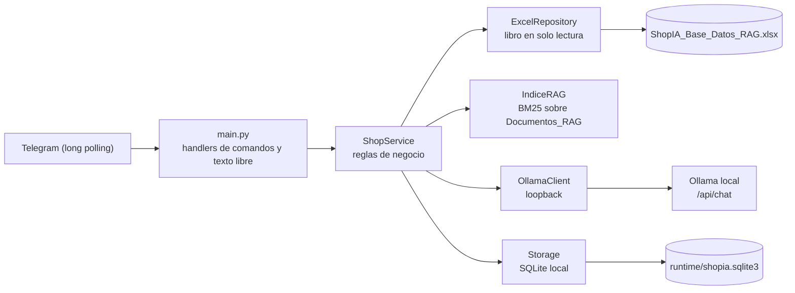

# ShopIA

**Propuesta de chatbot de IA privada para empresas, con RAG empresarial sobre datos propios autorizados.**<br>
*Estado: prototipo de referencia. El repositorio contiene un sistema ejecutable que demuestra el enfoque sobre una tienda ficticia: bot de Telegram en español, búsqueda estructurada sobre un libro Excel local de solo lectura, RAG léxico (BM25) con Ollama local y pedidos simulados `SIM-`.*


---

### Resumen

La **propuesta** es un chatbot de IA privada para empresas. Su objetivo es que el asistente intente responder usando únicamente datos propios de la organización, previamente autorizados por ella, mediante RAG (recuperación de documentos antes de generar la respuesta). La inferencia del modelo ocurre en Ollama local y no se envía a proveedores externos de IA.

El **prototipo** es el sistema ejecutable de este repositorio. Ilustra el enfoque sobre una tienda ficticia: los precios, el stock, los envíos y las promociones salen del libro `ShopIA_Base_Datos_RAG.xlsx`, que el proyecto **lee en modo solo lectura**. El carrito y los pedidos se guardan en una base SQLite local. Los pedidos `SIM-` son simulados: no se cobra nada y el libro no se modifica.

> [!NOTE]
> **Estado: prototipo de referencia, no producto listo para producción.** No hay garantía de exactitud de las respuestas, ni validación de seguridad o de operación para uso real. Telegram es un servicio externo que transporta los mensajes y las respuestas, así que la privacidad del canal debe evaluarse antes de manejar datos reales. Cada organización debe conectar sus propias fuentes y validar sus permisos, esquemas y procesos. Ver [Propuesta adaptable](#propuesta-adaptable).

---

### Prototipo actual

| Componente | Qué hace hoy el prototipo |
|---|---|
| Canal | Bot de Telegram con long polling (sin webhooks). Telegram es un servicio externo: transporta los mensajes y las respuestas. |
| Fuente de datos | Libro `ShopIA_Base_Datos_RAG.xlsx` en solo lectura. **No incluido en el repositorio.** |
| Búsqueda estructurada | Consultas de catálogo (precio, stock, estado, presupuesto y ficha técnica) resueltas sin modelo. |
| RAG | Índice BM25 ligero sobre la hoja `Documentos_RAG`. Entrega al modelo hasta 5 documentos y hasta 3 productos reales, como datos no confiables. |
| Modelo | Inferencia en Ollama local, en loopback (`127.0.0.1`, `localhost` o `::1`), sin herramientas y sin proveedores externos de IA. Modelo configurable en `OLLAMA_MODEL`. |
| Tienda | Ficticia: catálogo, envíos, cupones y promociones de ejemplo. |
| Pedidos | Simulados con código `SIM-`. No cobran dinero ni modifican el libro; el stock consumido queda solo en SQLite local. |
| Persistencia | SQLite local: carritos, preferencias, pedidos e historial (máximo 8 intercambios por usuario). |

---

### Propuesta adaptable

La propuesta no consiste en desplegar el prototipo tal cual, sino en adaptarlo a cada organización. La adaptación afecta a varias capas, no solo a un módulo:

- **Conector de datos.** El prototipo lee un único libro Excel. Cada empresa debe definir cómo se conectan sus fuentes autorizadas (hojas, bases de datos o documentos internos), con acceso de solo lectura y los datos mínimos necesarios.
- **Recuperación.** El índice BM25 léxico del prototipo debe evaluarse frente al corpus real de cada organización. Puede requerir otra estrategia de indexación o de búsqueda, y su calidad no está medida en el prototipo.
- **Esquema.** Hojas, columnas, tipos y reglas de calidad deben corresponder a los datos reales de la organización. Hoy el arranque se detiene si faltan hojas o columnas esperadas, pero no valida el contenido.
- **Permisos.** El prototipo no implementa control de acceso por roles ni restringe qué documentos puede consultar cada usuario. Antes de indexar datos sensibles, la organización debe definir quién puede consultar cada fuente y comprobar que el sistema lo aplica.
- **Procesos de negocio.** Las reglas de envío, cupones, pedidos y disponibilidad son las de la tienda ficticia. Cada empresa debe establecer las suyas y verificarlas con sus responsables.
- **Privacidad, operación y despliegue.** Hay que evaluar el canal (Telegram es externo), la retención de datos, los registros, las copias de seguridad, el control de acceso a la máquina y las responsabilidades de mantenimiento. Nada de esto está resuelto en el prototipo.

---

### Fuente de datos (obligatoria, no incluida)

El libro `ShopIA_Base_Datos_RAG.xlsx` **es obligatorio para arrancar el prototipo** y **no forma parte del repositorio público**. Coloca una copia autorizada en la raíz del proyecto, o indica su ubicación en `EXCEL_PATH` dentro de `.env`. En una implementación adaptada, esta fuente se sustituye por la de cada organización.

- Si el libro falta, o le faltan hojas o columnas, `main.py` se detiene con un mensaje que nombra lo que falta (código de salida `3`).
- El programa solo lee el libro. Nunca lo escribe.
- El libro, los archivos de Excel temporales y cualquier copia local no deben subirse a Git.

---

### Requisitos

- Windows con PowerShell.
- Python 3.11 o superior. Los ejemplos usan `py -3.12`.
- Un token de BotFather para `TELEGRAM_BOT_TOKEN`. Solo hace falta para ejecutar el bot; `diagnostico.py` funciona sin él.
- Opcional, pero necesario para preguntas abiertas: Ollama instalado y en ejecución en la misma máquina, con el modelo `qwen2.5-coder:7b` u otro configurado en `OLLAMA_MODEL`.

---

### Instalación

Desde la carpeta del proyecto:

```powershell
py -3.12 -m venv .venv
.venv\Scripts\python.exe -m pip install -r requirements.txt
if (-not (Test-Path .env)) { Copy-Item .env.example .env }
```

El último comando crea `.env` solo si no existe, así que nunca sobrescribe tu configuración. Después, edita `.env` y completa `TELEGRAM_BOT_TOKEN` con el token de BotFather. Conserva las demás variables.

`.env` contiene secretos. Está excluido por `.gitignore` y no debe subirse nunca al repositorio.

#### Dependencias fijadas (`requirements.txt`)

| Paquete | Versión | Uso |
|---|---|---|
| `python-telegram-bot` | 22.8 | Bot y long polling |
| `openpyxl` | 3.1.5 | Lectura del libro en solo lectura |
| `httpx` | 0.28.1 | Cliente HTTP local hacia Ollama |
| `python-dotenv` | 1.2.4 | Carga de `.env` |
| `pytest` | 9.1.1 | Solo para las pruebas (dependencia de desarrollo) |

---

### Configuración (`.env`)

| Variable | Valor por defecto | Descripción |
|---|---|---|
| `TELEGRAM_BOT_TOKEN` | (vacío) | Token de BotFather. Obligatorio solo para `main.py`. |
| `EXCEL_PATH` | `ShopIA_Base_Datos_RAG.xlsx` | Ruta del libro. Si es relativa, se resuelve desde la raíz del proyecto. |
| `SQLITE_PATH` | `runtime/shopia.sqlite3` | Base SQLite de carritos, preferencias, pedidos e historial. Se crea al arrancar. |
| `OLLAMA_BASE_URL` | `http://127.0.0.1:11434` | Solo se aceptan URLs de loopback (`127.0.0.1`, `localhost` o `::1`). |
| `OLLAMA_MODEL` | `qwen2.5-coder:7b` | Modelo que usa el asistente. |
| `OLLAMA_TIMEOUT_S` | `120` | Segundos máximos de espera por respuesta del modelo. Debe ser mayor que cero. |

ShopIA no usa proveedores de IA externos. Si `OLLAMA_BASE_URL` apunta a otra máquina, la configuración se rechaza al arrancar.

---

### Comprobaciones

```powershell
.venv\Scripts\python.exe diagnostico.py              # libro, token (solo presencia), Ollama y chat de prueba
.venv\Scripts\python.exe diagnostico.py --sin-ping   # igual, sin enviar mensaje al modelo
```

`diagnostico.py` valida el libro y muestra solo conteos de filas, nunca su contenido. Indica si `TELEGRAM_BOT_TOKEN` está presente, sin mostrar su valor. Comprueba que Ollama responde y que el modelo configurado está instalado. Sin `--sin-ping`, envía un mensaje de prueba al modelo. Si el libro falla, el estado global es `FALLIDO` y el código de salida es `1`.

#### Pruebas

```powershell
.venv\Scripts\python.exe -m pytest -q -p no:cacheprovider tests/test_shop.py
```

Las pruebas **necesitan el libro local** en la raíz del proyecto, porque leen sus valores esperados directamente con `openpyxl`. No necesitan token de Telegram ni Ollama: la red va simulada y las bases SQLite son temporales.

---

### Ejecutar el bot

```powershell
.venv\Scripts\python.exe main.py
```

El bot arranca con **long polling** (sin webhooks). Para detenerlo, pulsa `Ctrl+C`.

| Situación | Resultado |
|---|---|
| Falta `TELEGRAM_BOT_TOKEN` | Termina con un mensaje claro y código `2`. |
| Libro ausente o incompleto | Termina con un mensaje que nombra lo que falta y código `3`. |
| Ollama no responde al arrancar | El bot sigue funcionando en modo determinista y registra un aviso. |

---

### Comandos de Telegram

| Comando | Qué hace |
|---|---|
| `/start` | Muestra la ayuda y los botones Catálogo, Ofertas, Envíos y Carrito. |
| `/catalogo` | Categorías con el número de productos comprables. |
| `/buscar [texto y presupuesto]` | Hasta 4 productos comprables, ordenados por relevancia. Admite un presupuesto como `hasta S/ 2000`. |
| `/producto SKU` | Ficha del producto, precio, estado, stock y garantía. Indica si no está disponible. |
| `/comparar SKU1 SKU2` | Precio, garantía, stock y ficha técnica lado a lado. |
| `/agregar SKU [cantidad]` | Agrega al carrito. La cantidad va de 1 a 99 y se valida contra el stock. |
| `/carrito` | Muestra el carrito, el envío, el cupón y el total estimado. |
| `/quitar SKU` | Quita un producto del carrito. |
| `/vaciar` | Vacía el carrito. |
| `/envio [distrito]` | Tarifa, plazo y condición de envío gratis. Guarda el destino para la compra. Sin argumento, muestra el destino guardado. |
| `/promos` | Promociones vigentes hoy. |
| `/cupon CODIGO` | Guarda un cupón vigente. `/cupon quitar` lo elimina y `/cupon` sin argumento muestra el guardado. |
| `/comprar` | Crea un pedido `SIM-` simulado y muestra el resumen. Exige carrito, destino y productos disponibles. |
| `/pedido CODIGO` | Consulta un pedido `SIM-` de tu cuenta o un pedido de ejemplo (`DEMO-…`) del libro. |

Cualquier texto que no sea comando se interpreta como lenguaje natural (ver la sección siguiente).

---

### Lenguaje natural

El bot decide cómo responder según el mensaje. Las reglas se aplican en este orden:

| Tipo de mensaje | Cómo se resuelve | Ejemplos |
|---|---|---|
| Seguimiento | Usa solo el historial breve del mismo usuario (los últimos productos mostrados). | «¿y uno más barato?», «¿cuál tiene más RAM?» |
| Promociones | Lista las promociones vigentes. | «¿hay ofertas?» |
| Envío a un distrito | Cotiza el envío si el distrito aparece en el libro. No guarda el destino. | «¿cuánto cuesta el envío a <distrito>?» |
| Precio, costo, existencia o disponibilidad | **Búsqueda estructurada** sobre el catálogo, sin modelo. Muestra datos reales del libro. | «¿hay laptops?», «¿cuánto cuesta una laptop?» |
| Búsqueda con presupuesto o coincidencia directa | **Búsqueda estructurada**, sin modelo. | «laptop hasta S/ 2000 con 16 GB» |
| Pregunta abierta o recomendación | **RAG con Ollama**: recupera hasta 5 documentos del libro y hasta 3 productos reales, y los entrega al modelo como datos no confiables. | «¿qué laptop conviene para estudiar?», «¿cuál es la política de devoluciones?» |

Reglas que conviene conocer:

- La búsqueda con precio o disponibilidad no llama a Ollama. Solo las preguntas abiertas usan el modelo.
- Si Ollama no responde, el bot lo indica y sugiere comandos (`/buscar`, `/producto`, `/envio`, `/promos`) y temas relacionados del libro.
- El lenguaje natural **no realiza transacciones**: no agrega al carrito, no compra, no aplica cupones y no guarda destinos. Para eso se usan los comandos.
- El mensaje libre admite hasta 500 caracteres.

---

### Arquitectura



| Módulo | Responsabilidad |
|---|---|
| `main.py` | Arranque, handlers de Telegram, long polling y códigos de salida. |
| `config.py` | Lectura de `.env` y validación de variables. No exige token al importarse. |
| `shop_service.py` | Reglas de catálogo, búsqueda, carrito, envíos, cupones, pedidos y enrutado de lenguaje natural. |
| `excel_repository.py` | Carga del libro en memoria (solo lectura) y consultas de productos, zonas, promociones y documentos. |
| `retrieval.py` | Índice BM25 sobre `Documentos_RAG`, con saneado del texto recuperado. |
| `ollama_client.py` | Cliente HTTP hacia Ollama (`/api/tags` y `/api/chat`), sin herramientas. |
| `storage.py` | Carritos, preferencias, pedidos `SIM-` e historial en SQLite. |
| `diagnostico.py` | Comprobaciones de arranque sin Telegram. |

---

### Reglas principales

- **Disponibilidad:** un producto es comprable si su estado es `Activo` y su stock agregado (suma de los almacenes del libro) es mayor que cero.
- **Stock:** el carrito no reserva unidades. El consumo simulado sale de los pedidos `SIM-` guardados en SQLite.
- **Envío:** el envío gratis se compara con el subtotal antes de cupones. Si el destino coincide con varias zonas, el bot pide el distrito exacto.
- **Cupones:** se validan fecha, estado, categoría, monto mínimo y tope definidos en el libro. Un cupón no aplicable se informa y no se aplica.
- **Pedidos:** un pedido `SIM-` no cobra dinero ni modifica el libro. Solo se consulta desde la cuenta de Telegram que lo creó.
- **Historial:** se guarda por usuario de Telegram, con un máximo de 8 intercambios. Solo guarda la intención y los SKU mencionados, nunca el texto libre del usuario.
- **Asistente:** Ollama recibe las instrucciones del sistema, los documentos recuperados delimitados como datos no confiables y los datos estructurados relevantes. No recibe el historial completo ni el libro entero, no usa herramientas y no decide compras ni precios.

---

### Escenario de prueba del prototipo

Usa tus propias consultas al libro para obtener SKU, precios y códigos reales. Los valores de ejemplo no están en este documento.

1. **Búsqueda con presupuesto.** Envía `laptop hasta S/ <presupuesto> con <característica>`. Debes ver hasta 4 productos comprables con SKU, precio, estado y stock.
2. **Disponibilidad.** Envía `¿hay <producto>?` y `¿cuánto cuesta un <producto>?`. La respuesta sale del catálogo, sin modelo.
3. **Carrito y pedido.** Busca un producto y copia su SKU. Después ejecuta en orden: `/agregar SKU 1`, `/envio <distrito>`, `/carrito` y `/comprar`. Anota el `SIM-` que devuelve y consúltalo con `/pedido SIM-…`.
4. **Pregunta abierta.** Con Ollama en ejecución, envía una pregunta sobre una política o una recomendación. La respuesta usa el modelo y se apoya en el libro.

---

### Seguridad y datos locales

- El token de Telegram vive solo en `.env`. No debe aparecer en Git, capturas, logs ni documentación.
- El bot no escribe el token en los registros: silencia los mensajes de `httpx`, que incluyen la URL con el token.
- Los errores internos se responden de forma genérica y en el registro solo se guarda el tipo de excepción.
- Solo se habla con Ollama en loopback. La inferencia no se envía a proveedores externos de IA.
- **Telegram es un servicio externo.** Los mensajes de los usuarios y las respuestas del bot pasan por sus servidores. La privacidad de este canal debe evaluarse antes de manejar datos reales.
- **Identificador de usuario:** el bot no solicita datos personales ni de pago (nombre, domicilio, tarjeta, DNI o contraseñas). Sí usa el ID numérico de Telegram como clave para aislar carritos, preferencias, pedidos e historial de cada usuario. Las preferencias incluyen el distrito de envío elegido con `/envio` y el cupón guardado con `/cupon`. El historial guarda solo la intención y los SKU, nunca el texto libre.
- Los datos quedan en la máquina local:

| Elemento | Dónde queda | Nota |
|---|---|---|
| `.env` | Raíz del proyecto | Excluido por `.gitignore`. |
| `runtime/` y SQLite | Carpeta `runtime/` | Excluidos por `.gitignore`. |
| `.venv/` y cachés (`__pycache__`, `.pytest_cache`) | Raíz del proyecto | Excluidos por `.gitignore`. |
| `ShopIA_Base_Datos_RAG.xlsx` | Raíz del proyecto o `EXCEL_PATH` | Obligatorio y no publicado. Nunca lo subas al repositorio. |
| `graphify-out/` | Raíz del proyecto | Artefactos locales de análisis. No se suben al repositorio. |

---

### Estructura del repositorio

```text
.
├── main.py              # Bot de Telegram (long polling)
├── config.py            # Configuración desde .env
├── shop_service.py      # Reglas de negocio y lenguaje natural
├── excel_repository.py  # Lectura del libro (solo lectura)
├── retrieval.py         # Índice RAG (BM25) y saneado
├── ollama_client.py     # Cliente local de Ollama
├── storage.py           # SQLite: carritos, pedidos SIM-, historial
├── diagnostico.py       # Diagnóstico sin Telegram
├── tests/
│   └── test_shop.py     # Pruebas (red mockeada)
├── requirements.txt     # Dependencias fijadas
├── .env.example         # Plantilla de configuración (sin secretos)
└── .gitignore
```

---

### Solución de problemas

| Síntoma | Qué revisar |
|---|---|
| `Falta TELEGRAM_BOT_TOKEN` | Completa la variable en `.env` y vuelve a ejecutar `main.py`. |
| `No se encontró el libro Excel` | Coloca el libro en la raíz o corrige `EXCEL_PATH`. |
| `Faltan hojas` o `Faltan columnas` | El libro no tiene la estructura esperada. Usa una copia autorizada. |
| Las preguntas abiertas responden con un aviso | Inicia Ollama, confirma `OLLAMA_BASE_URL` y ejecuta `diagnostico.py`. |
| `El modelo … no aparece instalado` | Instala el modelo en Ollama o cambia `OLLAMA_MODEL`. |
| La primera respuesta del modelo tarda mucho | Es la carga en frío del modelo. Reintenta o aumenta `OLLAMA_TIMEOUT_S`. |
| `OLLAMA_BASE_URL debe apuntar a localhost` | Usa una URL de loopback. ShopIA no admite proveedores externos. |

---

### Limitaciones

- **Búsqueda léxica (BM25), no semántica.** Solo reconoce unas pocas equivalencias de lenguaje común (por ejemplo, «portátil» y «notebook» hacia laptop). Las respuestas del modelo pueden ser incorrectas o incompletas: el prototipo no garantiza exactitud.
- **Libro local ficticio.** Los datos del prototipo son de ejemplo y no representan a ninguna empresa real.
- **Sin Ollama:** el bot sigue operativo para búsqueda, carrito, envíos, cupones y pedidos. Las preguntas abiertas responden con un aviso.
- **Simulación:** no hay pagos ni facturación, y el bot no solicita datos personales ni de pago. El stock se descuenta solo en la base local al confirmar un pedido `SIM-`.
- **Sin control de acceso por roles ni auditoría de consultas al corpus.** Solo existe la separación por ID de Telegram descrita arriba.
- **No validado para producción:** no hay pruebas de carga, de seguridad dinámica ni de operación continua. Cualquier uso con datos reales requiere una evaluación propia de la organización.
- **Alcance de la verificación:** `tests/test_shop.py` usa mocks de red (`httpx.MockTransport`) y bases SQLite temporales. No valida conexiones reales con Telegram ni con Ollama. `diagnostico.py` revisa el libro y el servicio Ollama local, pero no se conecta a Telegram. Ejecuta `diagnostico.py` y las pruebas en tu entorno antes de usar el prototipo.
