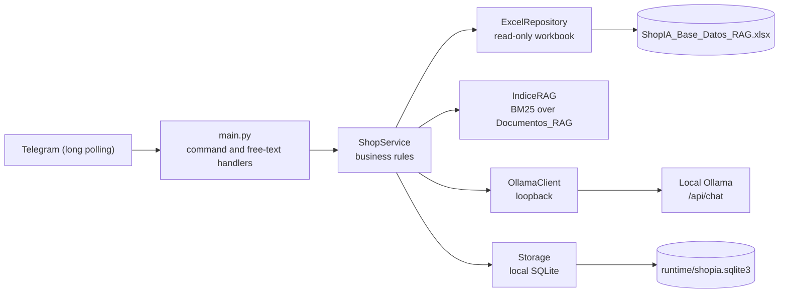

# ShopIA

**Proposal for a private AI chatbot for businesses, with enterprise RAG over the organization's own authorized data.**<br>
*Status: reference prototype. The repository contains an executable system that demonstrates the approach on a fictional store: a Telegram bot that replies in Spanish, structured search over a local read-only Excel workbook, lexical RAG (BM25) with local Ollama, and simulated `SIM-` orders.*


---

### Summary

The **proposal** is a private AI chatbot for businesses. Its goal is for the assistant to try to answer using only the organization's own data, previously authorized by that organization, through RAG (retrieving documents before generating the answer). Model inference runs on local Ollama and is not sent to external AI providers.

The **prototype** is the executable system in this repository. It illustrates the approach on a fictional store: prices, stock, shipping and promotions come from the `ShopIA_Base_Datos_RAG.xlsx` workbook, which the project **reads in read-only mode**. Carts and orders are stored in a local SQLite database. `SIM-` orders are simulated: nothing is charged and the workbook is not modified.

> [!NOTE]
> **Status: reference prototype, not production-ready software.** There is no guarantee that answers are accurate, and there is no security or operational validation for real-world use. Telegram is an external service that carries the messages and replies, so the privacy of the channel must be assessed before handling real data. Each organization must connect its own sources and validate its permissions, schemas and processes. See [Adaptable proposal](#adaptable-proposal).

---

### Current prototype

| Component | What the prototype does today |
|---|---|
| Channel | Telegram bot using long polling (no webhooks). Telegram is an external service: it carries the messages and replies. |
| Data source | `ShopIA_Base_Datos_RAG.xlsx` workbook, read-only. **Not included in the repository.** |
| Structured search | Catalog queries (price, stock, status, budget and technical sheet) answered without a model. |
| RAG | Lightweight BM25 index over the `Documentos_RAG` sheet. Passes the model up to 5 documents and up to 3 real products, as untrusted data. |
| Model | Local Ollama inference on loopback (`127.0.0.1`, `localhost` or `::1`), with no tools and no external AI providers. Model configurable in `OLLAMA_MODEL`. |
| Store | Fictional: sample catalog, shipping, coupons and promotions. |
| Orders | Simulated, with `SIM-` codes. They do not charge money or modify the workbook; consumed stock is recorded only in the local SQLite database. |
| Persistence | Local SQLite: carts, preferences, orders and history (maximum of 8 exchanges per user). |

---

### Adaptable proposal

The proposal is not to deploy the prototype as-is, but to adapt it to each organization. The adaptation affects several layers, not just one module:

- **Data connector.** The prototype reads a single Excel workbook. Each company must define how its authorized sources are connected (sheets, databases or internal documents), with read-only access and the minimum data necessary.
- **Retrieval.** The prototype's lexical BM25 index must be evaluated against each organization's real corpus. It may require a different indexing or search strategy, and its quality is not measured in the prototype.
- **Schema.** Sheets, columns, types and quality rules must match the organization's real data. Today, startup stops if expected sheets or columns are missing, but it does not validate the content.
- **Permissions.** The prototype does not implement role-based access control and does not restrict which documents each user can query. Before indexing sensitive data, the organization must define who may query each source and verify that the system enforces it.
- **Business processes.** The shipping, coupon, order and availability rules are those of the fictional store. Each company must establish its own and verify them with its managers.
- **Privacy, operations and deployment.** The channel (Telegram is external), data retention, logs, backups, access control to the machine and maintenance responsibilities must all be assessed. None of this is addressed in the prototype.

---

### Data source (required, not included)

The `ShopIA_Base_Datos_RAG.xlsx` workbook **is required to start the prototype** and **is not part of the public repository**. Place an authorized copy in the project root, or set its location in `EXCEL_PATH` inside `.env`. In an adapted implementation, this source is replaced by the organization's own.

- If the workbook is missing, or is missing sheets or columns, `main.py` stops with a message that names what is missing (exit code `3`).
- The program only reads the workbook. It never writes to it.
- The workbook, temporary Excel files and any local copies must not be uploaded to Git.

---

### Requirements

- Windows with PowerShell.
- Python 3.11 or later. The examples use `py -3.12`.
- A BotFather token for `TELEGRAM_BOT_TOKEN`. It is only needed to run the bot; `diagnostico.py` works without it.
- Optional, but required for open-ended questions: Ollama installed and running on the same machine, with the `qwen2.5-coder:7b` model or another model set in `OLLAMA_MODEL`.

---

### Installation

From the project folder:

```powershell
py -3.12 -m venv .venv
.venv\Scripts\python.exe -m pip install -r requirements.txt
if (-not (Test-Path .env)) { Copy-Item .env.example .env }
```

The last command creates `.env` only if it does not already exist, so it never overwrites your configuration. Then edit `.env` and fill in `TELEGRAM_BOT_TOKEN` with the BotFather token. Keep the other variables.

`.env` contains secrets. It is excluded by `.gitignore` and must never be committed to the repository.

#### Pinned dependencies (`requirements.txt`)

| Package | Version | Purpose |
|---|---|---|
| `python-telegram-bot` | 22.8 | Bot and long polling |
| `openpyxl` | 3.1.5 | Read-only access to the workbook |
| `httpx` | 0.28.1 | Local HTTP client for Ollama |
| `python-dotenv` | 1.2.4 | Loads `.env` |
| `pytest` | 9.1.1 | Tests only (development dependency) |

---

### Configuration (`.env`)

| Variable | Default value | Description |
|---|---|---|
| `TELEGRAM_BOT_TOKEN` | (empty) | BotFather token. Required only for `main.py`. |
| `EXCEL_PATH` | `ShopIA_Base_Datos_RAG.xlsx` | Path to the workbook. If relative, it is resolved from the project root. |
| `SQLITE_PATH` | `runtime/shopia.sqlite3` | SQLite database for carts, preferences, orders and history. Created at startup. |
| `OLLAMA_BASE_URL` | `http://127.0.0.1:11434` | Only loopback URLs are accepted (`127.0.0.1`, `localhost` or `::1`). |
| `OLLAMA_MODEL` | `qwen2.5-coder:7b` | Model used by the assistant. |
| `OLLAMA_TIMEOUT_S` | `120` | Maximum seconds to wait for a model response. Must be greater than zero. |

ShopIA does not use external AI providers. If `OLLAMA_BASE_URL` points to another machine, the configuration is rejected at startup.

---

### Checks

```powershell
.venv\Scripts\python.exe diagnostico.py              # workbook, token (presence only), Ollama and a test chat
.venv\Scripts\python.exe diagnostico.py --sin-ping   # same, without sending a message to the model
```

`diagnostico.py` validates the workbook and shows only row counts, never its contents. It reports whether `TELEGRAM_BOT_TOKEN` is present, without showing its value. It checks that Ollama responds and that the configured model is installed. Without `--sin-ping`, it sends a test message to the model. If the workbook check fails, the overall status is `FALLIDO` (the literal status printed by the script) and the exit code is `1`.

#### Tests

```powershell
.venv\Scripts\python.exe -m pytest -q -p no:cacheprovider tests/test_shop.py
```

The tests **require the local workbook** in the project root, because they read the expected values directly with `openpyxl`. They do not need a Telegram token or Ollama: network calls are simulated and the SQLite databases are temporary.

---

### Running the bot

```powershell
.venv\Scripts\python.exe main.py
```

The bot starts with **long polling** (no webhooks). To stop it, press `Ctrl+C`.

| Situation | Result |
|---|---|
| `TELEGRAM_BOT_TOKEN` is missing | Exits with a clear message and code `2`. |
| Workbook missing or incomplete | Exits with a message that names what is missing, and code `3`. |
| Ollama does not respond at startup | The bot keeps working in deterministic mode and logs a warning. |

---

### Telegram commands

| Command | What it does |
|---|---|
| `/start` | Shows help and the buttons *Catálogo* (Catalog), *Ofertas* (Offers), *Envíos* (Shipping) and *Carrito* (Cart). |
| `/catalogo` | Categories with the number of purchasable products. |
| `/buscar [texto y presupuesto]` | Up to 4 purchasable products, sorted by relevance. Accepts a budget such as `hasta S/ 2000` (Spanish example, meaning "up to S/ 2000"). |
| `/producto SKU` | Product sheet, price, status, stock and warranty. Indicates if it is not available. |
| `/comparar SKU1 SKU2` | Price, warranty, stock and technical sheet side by side. |
| `/agregar SKU [cantidad]` | Adds to the cart. Quantity ranges from 1 to 99 and is validated against stock. |
| `/carrito` | Shows the cart, shipping, coupon and estimated total. |
| `/quitar SKU` | Removes a product from the cart. |
| `/vaciar` | Empties the cart. |
| `/envio [distrito]` | Shipping fee, lead time and free-shipping condition. Saves the destination for checkout. Without an argument, shows the saved destination. |
| `/promos` | Promotions valid today. |
| `/cupon CODIGO` | Saves a valid coupon. `/cupon quitar` removes it, and `/cupon` without an argument shows the saved coupon. |
| `/comprar` | Creates a simulated `SIM-` order and shows the summary. Requires a cart, a destination and available products. |
| `/pedido CODIGO` | Looks up a `SIM-` order from your account, or a sample order (`DEMO-…`) from the workbook. |

Any text that is not a command is interpreted as natural language (see the next section).

---

### Natural language

The bot decides how to respond based on the message. The rules are applied in this order. The Spanish examples below are literal inputs the bot understands; their English meanings are given in parentheses.

| Message type | How it is handled | Examples |
|---|---|---|
| Follow-up | Uses only the short history of the same user (the most recently shown products). | «¿y uno más barato?» (Spanish example: "and a cheaper one?"), «¿cuál tiene más RAM?» (Spanish example: "which one has more RAM?") |
| Promotions | Lists the current promotions. | «¿hay ofertas?» (Spanish example: "are there any offers?") |
| Shipping to a district | Quotes shipping if the district appears in the workbook. Does not save the destination. | «¿cuánto cuesta el envío a <distrito>?» (Spanish example: "how much is shipping to <district>?") |
| Price, cost, stock or availability | **Structured search** over the catalog, without a model. Shows real data from the workbook. | «¿hay laptops?» (Spanish example: "are there laptops?"), «¿cuánto cuesta una laptop?» (Spanish example: "how much does a laptop cost?") |
| Search with budget or direct match | **Structured search**, without a model. | «laptop hasta S/ 2000 con 16 GB» (Spanish example: "laptop up to S/ 2000 with 16 GB") |
| Open question or recommendation | **RAG with Ollama**: retrieves up to 5 documents from the workbook and up to 3 real products, and passes them to the model as untrusted data. | «¿qué laptop conviene para estudiar?» (Spanish example: "which laptop is good for studying?"), «¿cuál es la política de devoluciones?» (Spanish example: "what is the return policy?") |

Rules worth knowing:

- Searches by price or availability do not call Ollama. Only open questions use the model.
- If Ollama does not respond, the bot says so and suggests commands (`/buscar`, `/producto`, `/envio`, `/promos`) and related topics from the workbook.
- Natural language **does not perform transactions**: it does not add to the cart, place orders, apply coupons or save destinations. Use the commands for that.
- Free-text messages accept up to 500 characters.

---

### Architecture



| Module | Responsibility |
|---|---|
| `main.py` | Startup, Telegram handlers, long polling and exit codes. |
| `config.py` | Reads `.env` and validates variables. Does not require a token on import. |
| `shop_service.py` | Rules for the catalog, search, cart, shipping, coupons, orders and natural-language routing. |
| `excel_repository.py` | Loads the workbook into memory (read-only) and queries products, zones, promotions and documents. |
| `retrieval.py` | BM25 index over `Documentos_RAG`, with sanitization of the retrieved text. |
| `ollama_client.py` | HTTP client for Ollama (`/api/tags` and `/api/chat`), without tools. |
| `storage.py` | Carts, preferences, `SIM-` orders and history in SQLite. |
| `diagnostico.py` | Startup checks without Telegram. |

---

### Core rules

- **Availability:** a product is purchasable if its status is `Activo` (the status value used in the workbook) and its aggregated stock (the sum across the workbook's warehouses) is greater than zero.
- **Stock:** the cart does not reserve units. Simulated consumption comes from the `SIM-` orders saved in SQLite.
- **Shipping:** free shipping is compared against the subtotal before coupons. If the destination matches several zones, the bot asks for the exact district.
- **Coupons:** the date, status, category, minimum amount and cap defined in the workbook are validated. A coupon that does not apply is reported and not applied.
- **Orders:** a `SIM-` order does not charge money or modify the workbook. It can only be queried from the Telegram account that created it.
- **History:** stored per Telegram user, with a maximum of 8 exchanges. It stores only the intent and the mentioned SKUs, never the user's free text.
- **Assistant:** Ollama receives the system instructions, the retrieved documents delimited as untrusted data, and the relevant structured data. It does not receive the full history or the entire workbook, does not use tools, and does not decide purchases or prices.

---

### Prototype test scenario

Use your own queries against the workbook to obtain real SKUs, prices and codes. Example values are not included in this document. The Spanish inputs below are literal examples; their English meanings are given in parentheses.

1. **Budget search.** Send `laptop hasta S/ <presupuesto> con <característica>` (Spanish example: "laptop up to S/ <budget> with <feature>"). You should see up to 4 purchasable products with SKU, price, status and stock.
2. **Availability.** Send `¿hay <producto>?` and `¿cuánto cuesta un <producto>?` (Spanish examples: "is there a <product>?" and "how much does a <product> cost?"). The answer comes from the catalog, without a model.
3. **Cart and order.** Search for a product and copy its SKU. Then run, in order: `/agregar SKU 1`, `/envio <distrito>`, `/carrito` and `/comprar`. Note the `SIM-` code it returns and look it up with `/pedido SIM-…`.
4. **Open question.** With Ollama running, send a question about a policy or a recommendation. The answer uses the model and is grounded in the workbook.

---

### Security and local data

- The Telegram token lives only in `.env`. It must not appear in Git, screenshots, logs or documentation.
- The bot does not write the token to the logs: it silences the `httpx` messages, which include the URL with the token.
- Internal errors are answered generically, and the log records only the exception type.
- Ollama is contacted only on loopback. Inference is not sent to external AI providers.
- **Telegram is an external service.** Users' messages and the bot's replies pass through its servers. The privacy of this channel must be assessed before handling real data.
- **User identifier:** the bot does not ask for personal or payment data (name, address, card, national ID or passwords). It does use the numeric Telegram ID as the key that isolates each user's carts, preferences, orders and history. Preferences include the shipping district chosen with `/envio` and the coupon saved with `/cupon`. History stores only the intent and SKUs, never free text.
- Data stays on the local machine:

| Item | Where it lives | Note |
|---|---|---|
| `.env` | Project root | Excluded by `.gitignore`. |
| `runtime/` and SQLite | `runtime/` folder | Excluded by `.gitignore`. |
| `.venv/` and caches (`__pycache__`, `.pytest_cache`) | Project root | Excluded by `.gitignore`. |
| `ShopIA_Base_Datos_RAG.xlsx` | Project root or `EXCEL_PATH` | Required and not published. Never upload it to the repository. |
| `graphify-out/` | Project root | Local analysis artifacts. Not uploaded to the repository. |

---

### Repository structure

```text
.
├── main.py              # Telegram bot (long polling)
├── config.py            # Configuration from .env
├── shop_service.py      # Business rules and natural language
├── excel_repository.py  # Workbook reading (read-only)
├── retrieval.py         # RAG index (BM25) and sanitization
├── ollama_client.py     # Local Ollama client
├── storage.py           # SQLite: carts, SIM- orders, history
├── diagnostico.py       # Diagnostics without Telegram
├── tests/
│   └── test_shop.py     # Tests (mocked network)
├── requirements.txt     # Pinned dependencies
├── .env.example         # Configuration template (no secrets)
└── .gitignore
```

---

### Troubleshooting

The left-hand column shows the literal messages the project prints (in Spanish).

| Symptom | What to check |
|---|---|
| `Falta TELEGRAM_BOT_TOKEN` | Fill in the variable in `.env` and run `main.py` again. |
| `No se encontró el libro Excel` | Place the workbook in the root folder or correct `EXCEL_PATH`. |
| `Faltan hojas` or `Faltan columnas` | The workbook does not have the expected structure. Use an authorized copy. |
| Open questions reply with a warning | Start Ollama, confirm `OLLAMA_BASE_URL` and run `diagnostico.py`. |
| `El modelo … no aparece instalado` | Install the model in Ollama or change `OLLAMA_MODEL`. |
| The first model response takes a long time | This is the model's cold start. Retry, or increase `OLLAMA_TIMEOUT_S`. |
| `OLLAMA_BASE_URL debe apuntar a localhost` | Use a loopback URL. ShopIA does not support external providers. |

---

### Limitations

- **Lexical search (BM25), not semantic.** It recognizes only a few common-language equivalences (for example, the Spanish terms «portátil» and «notebook» mapped to laptop). Model responses may be incorrect or incomplete: the prototype does not guarantee accuracy.
- **Fictional local workbook.** The prototype's data is sample data and does not represent any real company.
- **Without Ollama:** the bot remains operational for search, cart, shipping, coupons and orders. Open questions reply with a warning.
- **Simulation:** there are no payments or invoicing, and the bot does not ask for personal or payment data. Stock is deducted only in the local database, when a `SIM-` order is confirmed.
- **No role-based access control or audit of corpus queries.** The only separation is the Telegram ID separation described above.
- **Not validated for production:** there are no load, dynamic security or continuous operation tests. Any use with real data requires the organization's own assessment.
- **Scope of verification:** `tests/test_shop.py` uses network mocks (`httpx.MockTransport`) and temporary SQLite databases. It does not validate real connections to Telegram or Ollama. `diagnostico.py` checks the workbook and the local Ollama service, but does not connect to Telegram. Run `diagnostico.py` and the tests in your own environment before using the prototype.
